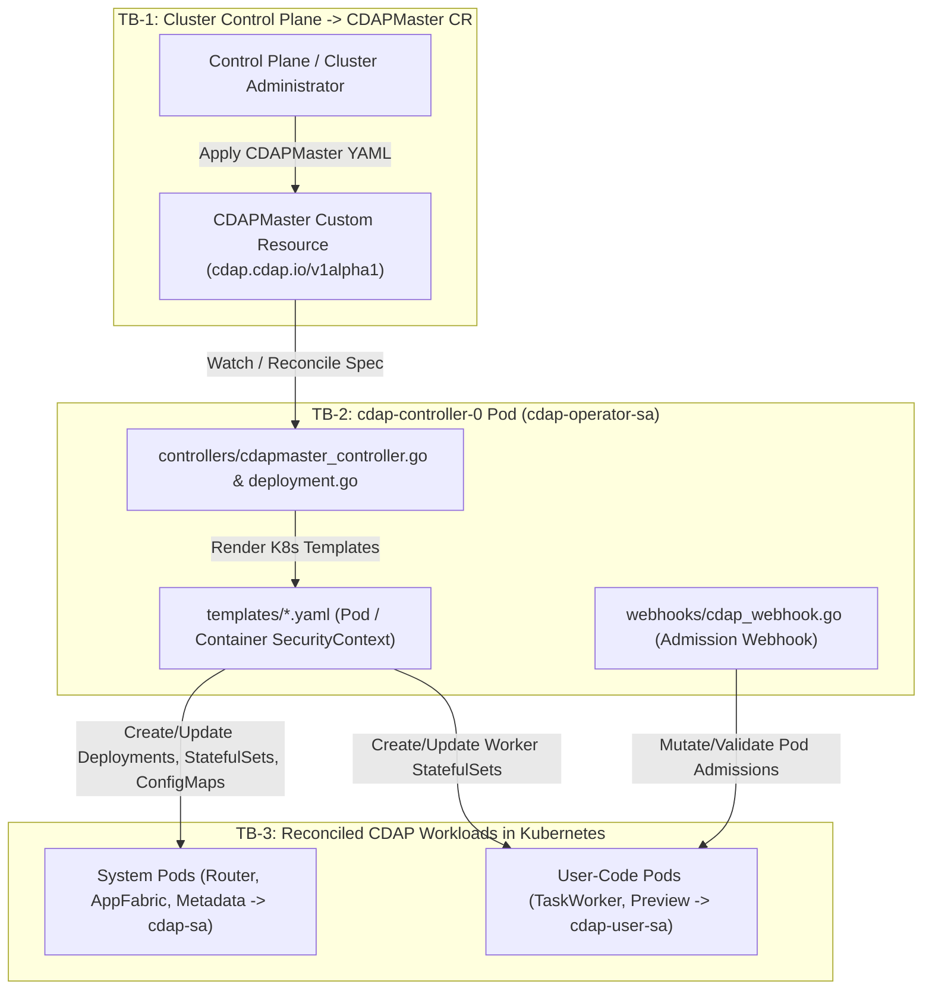

# Security Threat Model: CDAP Kubernetes Operator (`cdapio/cdap-operator`)

**Scope:** `https://github.com/cdapio/cdap-operator` (branches `develop`, `master`)  
**Components:** CRD Reconciler (`controllers/`), Custom Resource Definitions (`api/v1alpha1/`), Manifest Templates (`templates/`), and Admission Webhooks (`webhooks/`)

---

## 1. Asset Definition & Scope

This threat model defines the trust boundaries, untrusted inputs, Kubernetes identities, known sink classes, and security invariants for the **CDAP Kubernetes Operator** (`cdapio/cdap-operator`), the Go controller that reconciles the `CDAPMaster` Custom Resource (`cdap.cdap.io/v1alpha1`) into Kubernetes `Deployments`, `StatefulSets`, `Services`, `Jobs`, `ConfigMaps`, and `Ingress` objects.

- **CRD Reconciler & Lifecycle Controllers (`controllers/cdapmaster_controller.go`, `controllers/deployment.go`, `controllers/version_update.go`, `api/v1alpha1/cdapmaster_types.go`)**:
  - Watches `CDAPMaster` resources and reconciles the core CDAP workloads (`Router`, `UserInterface`, `AppFabric`, `AppFabricProcessor`, `Messaging`, `Metadata`, `Metrics`, `Logs`, `PreviewManager`, `Runtime`, `SystemWorker`, `TaskWorker`) plus `pre-upgrade` and `post-upgrade` Kubernetes `Jobs`.
- **Kubernetes Manifest Templates (`templates/*.yaml`, `templates/cdap-Deployment.yaml`, `templates/cdap-StatefulSet.yaml`, `templates/cdap-sts.yaml`)**:
  - Defines container specs, `initContainers` (`artifact-localizer`, network route initialization), volume mounts, environment variables, and `SecurityContext` settings rendered for each CDAP pod.
- **Admission Webhooks (`webhooks/cdap_webhook.go`)**:
  - Implements mutating and validating admission webhooks for CDAP pods in the cluster.

### Related Component Threat Models

- **CDAP Core Runtime (`cdapio/cdap`)**: `cdap/THREAT_MODEL.md`
- **CDAP Build & Packaging (`cdapio/cdap-build`)**: `cdap-build/THREAT_MODEL.md`
- **CDAP Web UI & Node.js Proxy (`cdapio/cdap-ui`)**: `cdap-ui/THREAT_MODEL.md`
- **Wrangler Data Prep Service & Directives (`data-integrations/wrangler`)**: `wrangler/THREAT_MODEL.md`
- **Hydrator Core & Database Plugins (`cdapio/hydrator-plugins`)**: `hydrator-plugins/THREAT_MODEL.md`

---

## 2. Trust Boundaries & Kubernetes Identities

### 2.1 Trust Boundaries

- **TB-1 (`CDAPMaster` Custom Resource -> Reconciler Config Generation Boundary)**:
  - User-supplied configuration options map into `CDAPMaster.Spec.Config` and `Spec.LogLevels`.
  - `cdap-operator` MUST validate `Spec.Config` keys and XML-escape all keys and values before generating `cdap-site.xml` or `logback.xml` `ConfigMaps`, and MUST NOT interpolate config values into container entrypoint shell commands (`sh -c`).
- **TB-2 (`cdap-operator-sa` -> Reconciled Workloads Pod Security Boundary)**:
  - `cdap-operator` itself (`cdap-controller-0`) and the workloads it renders (`templates/*.yaml`) must enforce Kubernetes **Restricted Pod Security Standards** (`runAsNonRoot: true`, `runAsUser: 1000`, `runAsGroup: 1000`, `allowPrivilegeEscalation: false`, `capabilities.drop: ["ALL"]`, `seccompProfile.type: RuntimeDefault`) across both main containers and `initContainers`.
- **TB-3 (Admission Webhook & ServiceAccount Separation Boundary)**:
  - `webhooks/cdap_webhook.go` and `controllers/deployment.go` must ensure that user-code pods (`TaskWorker`, `PreviewRunner`) are strictly bound to the isolated worker service account (`cdap-user-sa`, never `cdap-sa` or `cdap-operator-sa`) and cannot bypass webhook mutations via crafted pod labels.

### 2.2 Kubernetes Identities

| Identity | Scope & Privileges | Security Invariant |
|---|---|---|
| **`cdap-operator-sa` (Operator ServiceAccount)** | Bound to `cdap-controller-0` StatefulSet. Holds permissions to create/update/delete `Deployments`, `StatefulSets`, `Services`, `Jobs`, `ConfigMaps`, `PersistentVolumeClaims`, and `CDAPMaster` status. | Must never be assigned to any CDAP data-plane service pod (`Spec.ServiceAccountName` on `CDAPServiceSpec` must reject `cdap-operator-sa`). The operator container itself must run as non-root (`runAsNonRoot: true`). |
| **`cdap-sa` (System ServiceAccount) vs. `cdap-user-sa` (Worker ServiceAccount)** | Assigned by `cdap-operator` to reconciled system workloads (`cdap-sa`) vs. `TaskWorker` (`cdap-user-sa`). | `TaskWorker` (`Spec.TaskWorker`) MUST never inherit `Spec.ServiceAccountName` (`cdap-sa`) even if `Spec.TaskWorker.ServiceAccountName` is omitted. |

---

## 3. Untrusted Inputs & Entry Points

| Entry Point | Files / Functions | Inputs | Required Validation & Guards |
|---|---|---|---|
| **`CDAPMaster.Spec.Config` & `LogLevels` Map** | `controllers/cdapmaster_controller.go`, `controllers/deployment.go` (`buildConfigMap`) | `Spec.Config` (`map[string]string`), `Spec.LogLevels` | XML-escape all keys and values when serializing `cdap-site.xml` and `logback.xml`; reject control characters and path traversal in config keys. |
| **Workload Template Rendering (`templates/*.yaml`)** | `templates/cdap-Deployment.yaml`, `templates/cdap-StatefulSet.yaml`, `templates/cdap-sts.yaml`, `controllers/deployment.go` | `ServiceSpec` fields (`Image`, `ServiceAccountName`, `SecurityContext`, `Env`, `Resources`, `NodeSelector`, `RuntimeClassName`) | Default all containers and `initContainers` to Restricted Pod Security Standards (`runAsNonRoot: true`, `runAsUser: 1000`, `allowPrivilegeEscalation: false`, `capabilities.drop: ["ALL"]`, `seccompProfile.type: RuntimeDefault`). |
| **Admission Webhook (`webhooks/cdap_webhook.go`)** | `webhooks/cdap_webhook.go` (`Handle`) | Pod admission review requests (`Pod.Labels`, `Pod.Spec.Containers`, `Pod.Spec.InitContainers`) | Prevent label spoofing from bypassing security context or network configurations. |
| **Version Upgrade Controller (`controllers/version_update.go`)** | `controllers/version_update.go` | `Spec.Image`, patch revision version strings (`MAJOR.MINOR.PATCH.REVISION`) | Support hitless rolling updates on patch revisions while validating image URI format. |

---

## 4. Known Sink Classes & Vulnerability Patterns in Scope

1. **Insecure Pod & InitContainer `SecurityContext` Defaults**:
   - **Sinks**: `templates/*.yaml` and `controllers/deployment.go`.
   - **Mechanism**: Missing `runAsNonRoot: true`, `allowPrivilegeEscalation: false`, `capabilities.drop: ["ALL"]`, or `seccompProfile: RuntimeDefault` on `cdap-controller-0`, main CDAP containers, or `initContainers` increases container-escape blast radius if user code achieves code execution in a pod.
2. **XML / ConfigMap / Command Injection via `Spec.Config`**:
   - **Sinks**: `controllers/cdapmaster_controller.go` and `controllers/deployment.go` (`cdap-site.xml` generation and container entrypoint command construction).
   - **Mechanism**: If `cdap-operator` formats `cdap-site.xml` via raw string concatenation without XML escaping (`</value><property>...`) or interpolates config values into shell commands (`sh -c`), a configuration option value can inject arbitrary `cdap-site.xml` properties or shell commands.
3. **ServiceAccount Confusion & Webhook Bypass**:
   - **Sinks**: `controllers/deployment.go` and `webhooks/cdap_webhook.go`.
   - **Mechanism**: Ensuring `TaskWorker` never falls back to `cdap-sa` or `cdap-operator-sa`, and ensuring `cdap_webhook.go` cannot be bypassed by crafted pod labels.

---

## 5. Core Security Invariants

1. **Invariant OP-INV-01 (Restricted Pod Security Standards by Default)**: Every `Deployment`, `StatefulSet`, and `Job` rendered by `cdap-operator` (`templates/*.yaml`, `controllers/deployment.go`)—as well as the operator's own deployment—MUST enforce `runAsNonRoot: true`, `runAsUser: 1000`, `allowPrivilegeEscalation: false`, `capabilities.drop: ["ALL"]`, and `seccompProfile.type: RuntimeDefault` across all containers and `initContainers`.
2. **Invariant OP-INV-02 (Strict XML Escaping & Structured ConfigMap Generation)**: `Spec.Config` keys and values MUST be serialized into `cdap-site.xml` using a structured XML encoder (`encoding/xml`) so option values cannot inject XML tags or override protected properties.
3. **Invariant OP-INV-03 (Least-Privilege ServiceAccount Separation)**: `cdap-operator` MUST never assign `cdap-operator-sa` to any managed CDAP workload and MUST enforce that `TaskWorker` runs under `cdap-user-sa` (isolated from `cdap-sa`).
